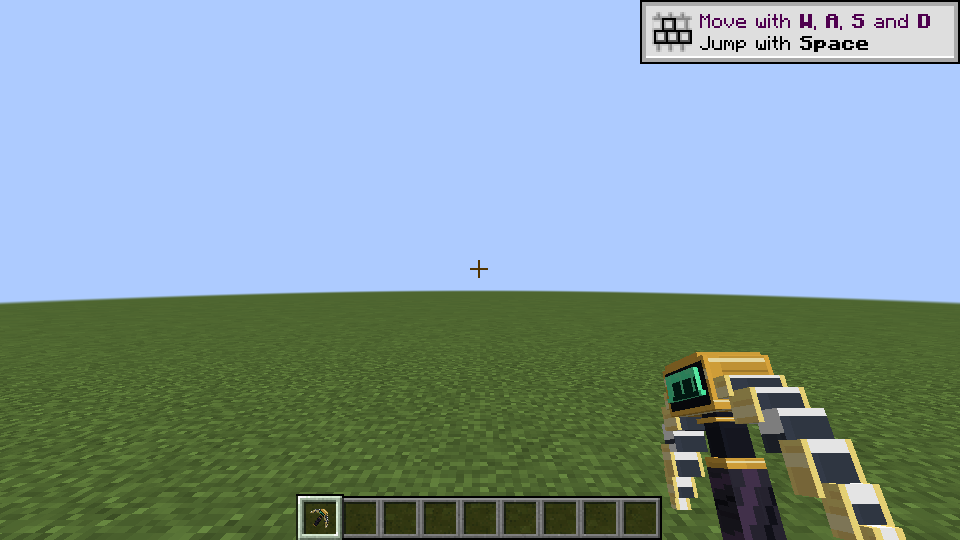
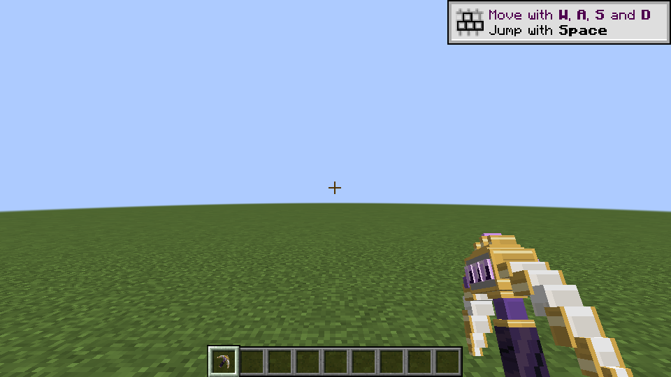
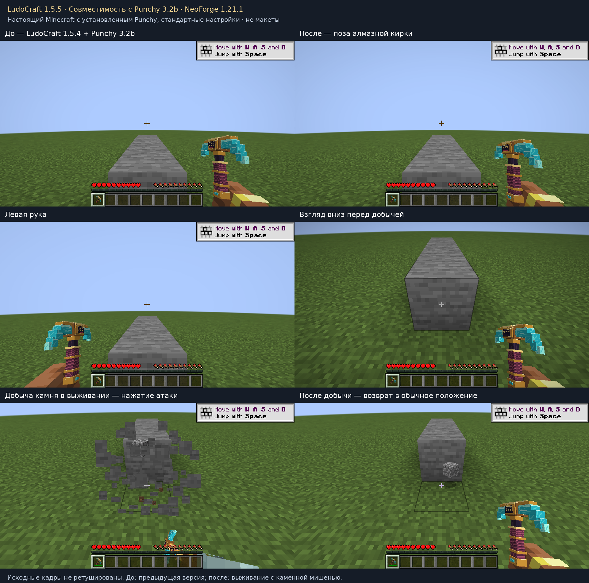
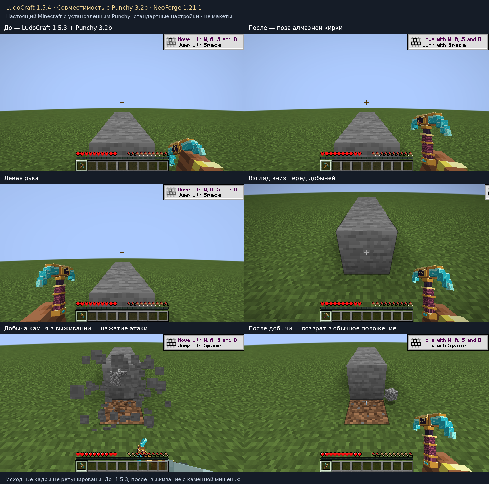
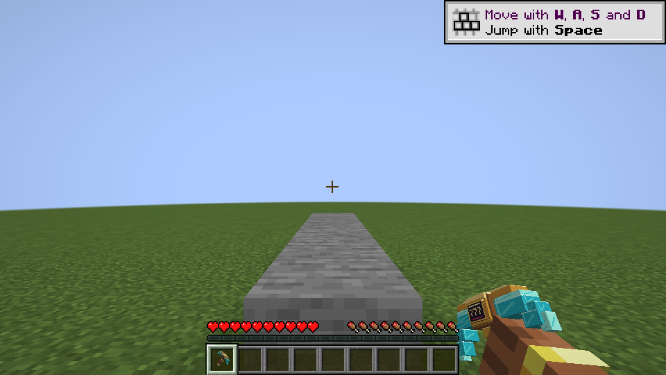
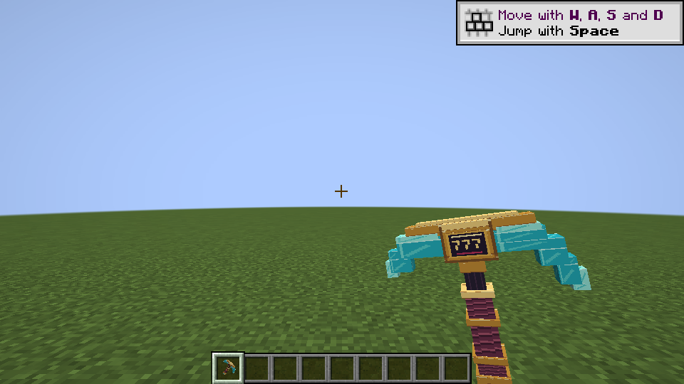
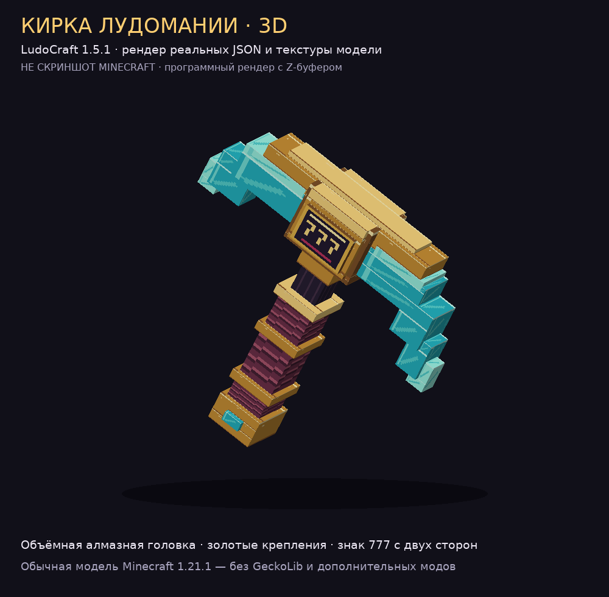
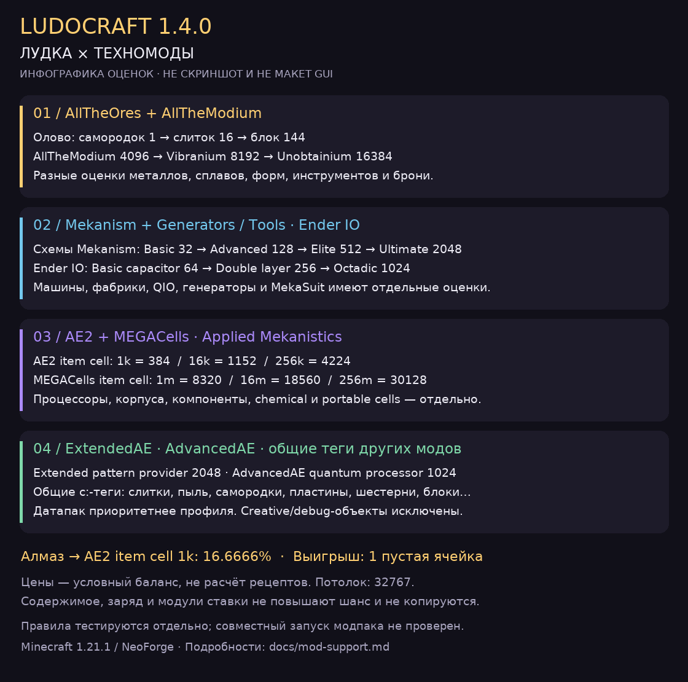
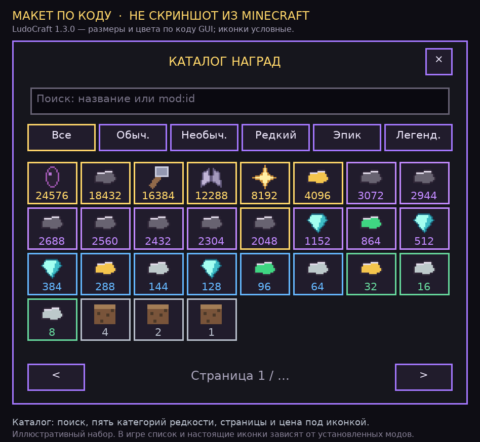

# Как выглядит LudoCraft

Здесь хранятся визуальные результаты обновлений: увеличенные текстуры, скриншоты
из игры и, при необходимости, явно подписанные макеты интерфейса.

**Это только документация.** Папка находится вне `src/main/resources` и каталогов
исходного кода, не подключена к Gradle source sets и не попадает в модовый JAR.
Готовые `.jar` по-прежнему публикуются в [Releases](https://github.com/nightmare-huy/LudoCraft-/releases).

## Версия 1.7.0 — обновлённые модели VIP и Highroller

**Тип изображений: реальные кадры первого лица из CI, vanilla NeoForge 1.21.1 без Punchy.**

| VIP Gambler’s Pickaxe | Highroller Pickaxe |
| --- | --- |
|  |  |

- [Обе кирки, реальные кадры и ограничения проверки](v1.7.0/vanilla/README.md)
- [Релиз 1.7.0](https://github.com/nightmare-huy/LudoCraft-/releases/tag/v1.7.0)

## Версия 1.5.5 — дополнительный сдвиг рукояти к ладони

**Тип изображений: реальные игровые кадры с Punchy 3.2b, автоматизированный клиент.**

- [Кадры 1.5.4 и 1.5.5, обе руки и проверка добычи](v1.5.5/punchy-comparison.png)
- [Изменение, runtime-проверки и ограничения](v1.5.5/README.md)
- [Релиз 1.5.5](https://github.com/nightmare-huy/LudoCraft-/releases/tag/v1.5.5)

## Версия 1.5.4 — положение как у алмазной кирки в Punchy

**Тип изображений: реальные автоматизированные игровые кадры с Punchy 3.2b.**

- [Сравнение 1.5.3 и 1.5.4, обе руки, добыча и восстановление](v1.5.4/punchy-comparison.png)
- [Как проверялись трансформы и что не проверено](v1.5.4/README.md)
- [Релиз 1.5.4](https://github.com/nightmare-huy/LudoCraft-/releases/tag/v1.5.4)

## Версия 1.5.3 — совместимость с Punchy 3.2b

**Тип изображений: НАСТОЯЩИЕ ИГРОВЫЕ СНИМКИ С УСТАНОВЛЕННЫМ PUNCHY 3.2b.**

- [Сравнение до/после, обе руки, взгляд вниз и реальная добыча](v1.5.3/punchy-comparison.png)
- [Происхождение кадров, проверки и ограничения](v1.5.3/README.md)
- [Релиз 1.5.3](https://github.com/nightmare-huy/LudoCraft-/releases/tag/v1.5.3)

## Версия 1.5.2 — исправление хвата кирки

**Тип изображений: НАСТОЯЩИЕ ИГРОВЫЕ СКРИНШОТЫ, автоматизированный тестовый мир.**

- [До/после, F5 спереди/сбоку, обе руки и взмах](v1.5.2/hand-comparison.png)
- [Исходные кадры, описание проверки и ограничения](v1.5.2/README.md)
- [Релиз 1.5.2](https://github.com/nightmare-huy/LudoCraft-/releases/tag/v1.5.2)

## Версия 1.5.1 — 3D-кирка

**Тип изображений: ПРОГРАММНЫЕ РЕНДЕРЫ РЕАЛЬНЫХ JSON/PNG, НЕ ИГРОВЫЕ СКРИНШОТЫ.**

- [Передняя/обратная стороны, толщина и GUI-положение](v1.5.1/pickaxe-inspection.png)
- [Подробности модели, проверок и ограничения](v1.5.1/README.md)
- [Релиз 1.5.1](https://github.com/nightmare-huy/LudoCraft-/releases/tag/v1.5.1)

## Версия 1.5.0 — профиль FTB Evolution 1.47.0

**Тип изображения: ИНФОГРАФИКА, НЕ СКРИНШОТ.** Цены и шансы взяты из правил
первого экспериментального профиля. Реальная сборка целиком и клиентский GUI не запускались.

- [Инструкция и источники](../balance/ftb-evolution-1.47.0.md)
- [Генератор](../../tools/generate_evolution_preview.py)
- [Релиз JAR и ZIP профиля](https://github.com/nightmare-huy/LudoCraft-/releases/tag/v1.5.0)

## Версия 1.4.0 — оценки предметов техномодов

**Тип изображения: ИНФОГРАФИКА, НЕ СКРИНШОТ И НЕ МАКЕТ GUI.**
Показывает конкретные цены профилей и градации ресурсов/ячеек. Основная раскладка
GUI не менялась; добавлены предупреждения о стандартной награде и потере содержимого
ставки в подсказках. Совместный запуск модпака и клиентская отрисовка не проверены.

- [Открыть изображение](v1.4.0/mod-support-overview.png)
- [Покрытие, ограничения и источники ID](../mod-support.md)
- [Генератор инфографики](../../tools/generate_mod_support_preview.py)

## Версия 1.3.0 — выбор желаемого предмета

**Тип изображений: МАКЕТЫ ПО КОДУ, НЕ СКРИНШОТЫ ИЗ ИГРЫ.**
Цвета и расположение элементов взяты из `LudkaScreen`; шрифт и иконки условные.
Реальный каталог строится из предметов установленных модов и содержит их игровые иконки.
Ручная проверка отрисовки Minecraft пока не выполнена.

### Основное меню — алмаз → незеритовый слиток

### Каталог наград

- [Основное меню отдельно](v1.3.0/main-menu-mockup.png)
- [Каталог отдельно](v1.3.0/catalogue-mockup.png)
- [Код интерфейса](../../src/main/java/ru/ludocraft/client/LudkaScreen.java)
- [Скрипт генерации макетов](../../tools/generate_ludka_previews.py)

## Версия 1.2.0 — Карманная Лудка

**Тип изображения:** превью реальной текстуры предмета из мода, не скриншот из игры.
Оригинал 32×32 увеличен без сглаживания и помещён на тёмный фон для удобного просмотра.

- [Открыть картинку отдельно](v1.2.0/pocket-ludka-texture.png)
- [Исходная игровая текстура](../../src/main/resources/assets/ludocraft/textures/item/pocket_ludka.png)
- [Релиз 1.2.0](https://github.com/nightmare-huy/LudoCraft-/releases/tag/v1.2.0)

## Как добавлять следующие результаты

- Для каждого обновления создавать подпапку `v<версия>/` и добавлять ссылку/изображение сюда.
- Старые превью сохранять, чтобы можно было сравнить изменения.
- Подписывать происхождение: **текстура из мода**, **скриншот из игры** или **макет**.
  Макет не выдавать за результат запуска Minecraft.
- При изменении интерфейса добавлять скриншот, если удалось запустить клиент;
  в противном случае — явно подписанный макет и указание, что проверка в игре не выполнена.
- Не хранить здесь JAR, миры, логи, кэши или промежуточные файлы сборки.
