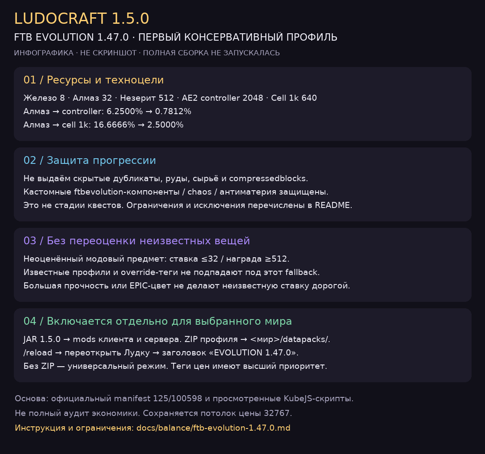
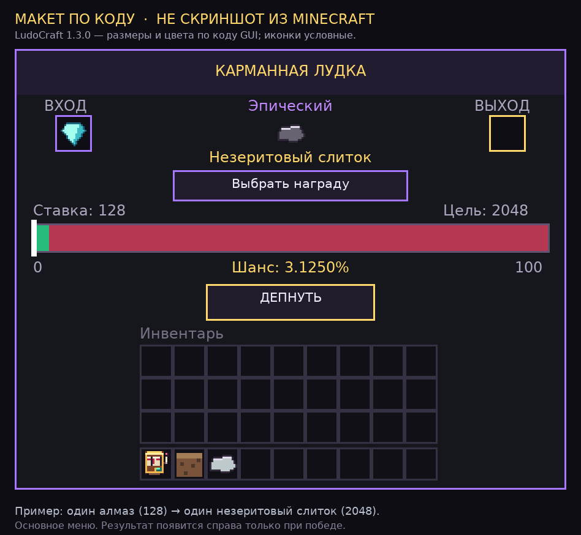
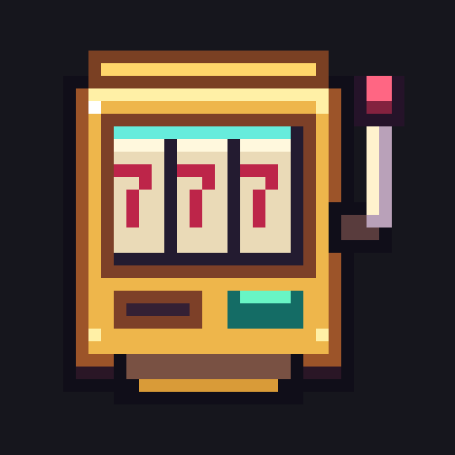

# Как выглядит LudoCraft

Здесь хранятся визуальные результаты обновлений: увеличенные текстуры, скриншоты
из игры и, при необходимости, явно подписанные макеты интерфейса.

**Это только документация.** Папка находится вне `src/main/resources` и каталогов
исходного кода, не подключена к Gradle source sets и не попадает в модовый JAR.
Готовые `.jar` по-прежнему публикуются в [Releases](https://github.com/nightmare-huy/LudoCraft-/releases).

## Версия 1.5.1 — 3D-кирка

**Тип изображений: ПРОГРАММНЫЕ РЕНДЕРЫ РЕАЛЬНЫХ JSON/PNG, НЕ ИГРОВЫЕ СКРИНШОТЫ.**

- [Передняя/обратная стороны, толщина и GUI-положение](v1.5.1/pickaxe-inspection.png)
- [Подробности модели, проверок и ограничения](v1.5.1/README.md)
- [Релиз 1.5.1](https://github.com/nightmare-huy/LudoCraft-/releases/tag/v1.5.1)

## Версия 1.5.0 — профиль FTB Evolution 1.47.0

**Тип изображения: ИНФОГРАФИКА, НЕ СКРИНШОТ.** Цены и шансы взяты из правил
первого экспериментального профиля. Реальная сборка целиком и клиентский GUI не запускались.

- [Инструкция и источники](../balance/ftb-evolution-1.47.0.md)
- [Генератор](../../tools/generate_evolution_preview.py)
- [Релиз JAR и ZIP профиля](https://github.com/nightmare-huy/LudoCraft-/releases/tag/v1.5.0)

## Версия 1.4.0 — оценки предметов техномодов

**Тип изображения: ИНФОГРАФИКА, НЕ СКРИНШОТ И НЕ МАКЕТ GUI.**
Показывает конкретные цены профилей и градации ресурсов/ячеек. Основная раскладка
GUI не менялась; добавлены предупреждения о стандартной награде и потере содержимого
ставки в подсказках. Совместный запуск модпака и клиентская отрисовка не проверены.

- [Открыть изображение](v1.4.0/mod-support-overview.png)
- [Покрытие, ограничения и источники ID](../mod-support.md)
- [Генератор инфографики](../../tools/generate_mod_support_preview.py)

## Версия 1.3.0 — выбор желаемого предмета

**Тип изображений: МАКЕТЫ ПО КОДУ, НЕ СКРИНШОТЫ ИЗ ИГРЫ.**
Цвета и расположение элементов взяты из `LudkaScreen`; шрифт и иконки условные.
Реальный каталог строится из предметов установленных модов и содержит их игровые иконки.
Ручная проверка отрисовки Minecraft пока не выполнена.

### Основное меню — алмаз → незеритовый слиток

### Каталог наград

- [Основное меню отдельно](v1.3.0/main-menu-mockup.png)
- [Каталог отдельно](v1.3.0/catalogue-mockup.png)
- [Код интерфейса](../../src/main/java/ru/ludocraft/client/LudkaScreen.java)
- [Скрипт генерации макетов](../../tools/generate_ludka_previews.py)

## Версия 1.2.0 — Карманная Лудка

**Тип изображения:** превью реальной текстуры предмета из мода, не скриншот из игры.
Оригинал 32×32 увеличен без сглаживания и помещён на тёмный фон для удобного просмотра.

- [Открыть картинку отдельно](v1.2.0/pocket-ludka-texture.png)
- [Исходная игровая текстура](../../src/main/resources/assets/ludocraft/textures/item/pocket_ludka.png)
- [Релиз 1.2.0](https://github.com/nightmare-huy/LudoCraft-/releases/tag/v1.2.0)

## Как добавлять следующие результаты

- Для каждого обновления создавать подпапку `v<версия>/` и добавлять ссылку/изображение сюда.
- Старые превью сохранять, чтобы можно было сравнить изменения.
- Подписывать происхождение: **текстура из мода**, **скриншот из игры** или **макет**.
  Макет не выдавать за результат запуска Minecraft.
- При изменении интерфейса добавлять скриншот, если удалось запустить клиент;
  в противном случае — явно подписанный макет и указание, что проверка в игре не выполнена.
- Не хранить здесь JAR, миры, логи, кэши или промежуточные файлы сборки.
