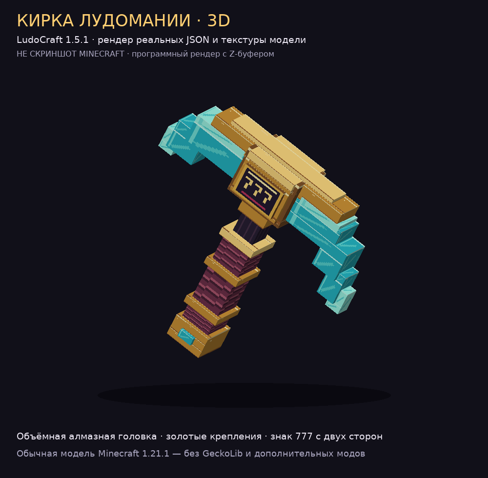
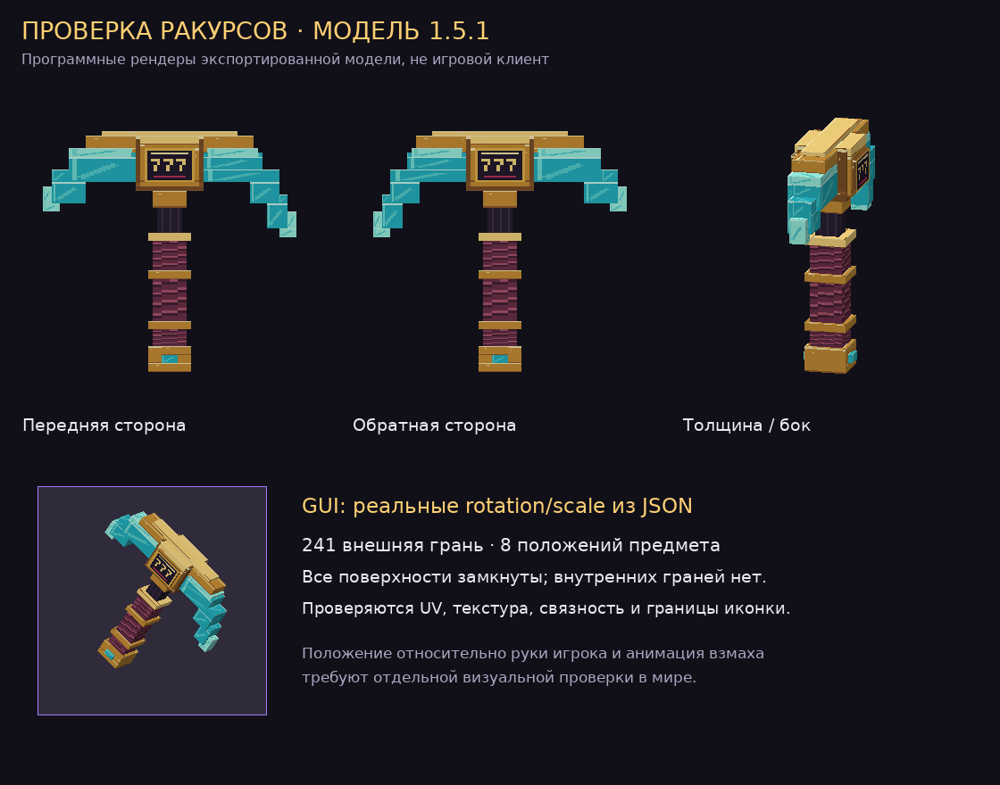

# Кирка Лудомании — 3D, LudoCraft 1.5.1



**Это программные рендеры настоящих JSON/PNG из мода, НЕ игровые скриншоты.**
Геометрия и UV читаются из экспортированной модели; изображение строится отдельным
простым рендерером с Z-буфером. Освещение отличается от Minecraft.

**Подтверждённый результат:** [Actions 43570895140](https://github.com/nightmare-huy/LudoCraft-/actions/runs/43570895140)
успешно прошёл для `6ecfecff5e8df8dd5f0900fe12b9cad14a771942`:
структурные проверки, реальный клиентский bake-test, 8 обычных + 2 Evolution
GameTests и проверка включения именно этих JSON/PNG в JAR.
[JAR 1.5.1 опубликован](https://github.com/nightmare-huy/LudoCraft-/releases/download/v1.5.1/ludocraft-1.5.1.jar).

## Что изменилось

- Вместо плоской `item/handheld`-иконки — собственная объёмная геометрия.
- Алмазная головка с двумя ступенчатыми концами, золотая спинка/крепления,
  бордовая обмотка рукояти, утолщённое навершие и таблички **777 с обеих сторон**.
- 241 внешняя грань, атлас 64×32, габариты модели в пределах 0…16.
- Стандартный формат модели Minecraft 1.21.1. **GeckoLib, OBJ-loader и отдельный
  ресурспак не требуются.** Модель находится внутри JAR и поддерживает обычный glint.
- Явные положения для GUI, рамки, земли, головы и обеих рук от первого/третьего лица.
- Версия строго **1.5.1**. Механика кирки, вероятности, меню Лудки, серверные
  транзакции и баланс Evolution из 1.5.0 не менялись.

## Осмотр с разных сторон



Квадрат GUI использует именно rotation/scale из JSON. Рендер бокового ракурса
показывает настоящую толщину, а не только фронтальную картинку.

## Защита от сломанной модели

Модель строится как объединение объёмных деталей на сетке 0.25. Затем экспортируется
только внешняя поверхность. Пересечения исходных деталей **не** оставляют наложенных
наружных граней или скрытых внутренних граней. В элементах JSON намеренно указано
по одной нужной грани: это законный vanilla-формат, а не отсутствующие стороны.

`tools/check_pickaxe_model.py` проверяет **экспортированный файл**, а не только эскиз:

1. JSON совпадает с воспроизводимым экспортом; нет generated-parent/кастомного loader.
2. Все части связаны; набор внешних квадратов полностью совпадает с оболочкой объёма.
3. Нет дублирующихся копланарных граней (причина z-fighting), нулевых размеров,
   NaN и координат вне разрешённой области.
4. Присутствуют все шесть направлений, отсутствуют block-only `cullface` и tint.
5. Все ссылки на текстуры существуют, атлас непрозрачный, UV лежат в 0…16.
6. Заданы восемь display-контекстов, масштабы положительные; GUI/рамка не выходят
   за область 16×16 после преобразования.

Отдельный dev-only `PickaxeModelSmokeTest` запускается **настоящим Minecraft-клиентом**
через Xvfb/Mesa в CI. После `ModelEvent.BakingCompleted` проверяет, что item-модель
не missing model и не плоская, движок выпёк 241 quad, все sprite-ссылки правильные,
позиции/UV конечны, все направления и display-преобразования доступны.
Этот тест не входит в распространяемый JAR и не запускается в игре пользователя.

Перед публикацией также выполняются прежние чистые тесты правил, 8 обычных и
2 Evolution GameTests; содержимое JAR сверяется с проверенными JSON/PNG.

**Ограничение:** bake-проверка не играет за персонажа и не заменяет визуальный
осмотр хвата, взмахов, зачарованного glint, FOV и сторонних шейдеров в реальном мире.
Здесь не заявляется ручное прохождение этого чек-листа или запуск всей FTB Evolution.

## Файлы и воспроизведение

- [Модель Minecraft](../../../src/main/resources/assets/ludocraft/models/item/gamblers_pickaxe.json)
- [Текстурный атлас](../../../src/main/resources/assets/ludocraft/textures/item/gamblers_pickaxe_3d.png)
- [Генератор модели и атласа](../../../tools/build_pickaxe_model.py)
- [Проверки](../../../tools/check_pickaxe_model.py)
- [Рендер превью](../../../tools/render_pickaxe_preview.py)

```sh
# Python + Pillow 13.0.0
python tools/build_pickaxe_model.py
python tools/check_pickaxe_model.py
python tools/render_pickaxe_preview.py
# Java 21 + графическая среда, либо xvfb-run в Linux
./gradlew runModelSmokeClient
```

Для установки заменить старый JAR на `ludocraft-1.5.1.jar`.
**Установленный Evolution-datapack 1.5.0 можно оставить**, второй экземпляр не нужен.
Старые предметы в инвентаре автоматически используют новую модель, выдавать кирку
заново не требуется. Если ресурспак переопределяет этот же item JSON, его нужно
отключить или обновить — он может скрывать новую модель.
