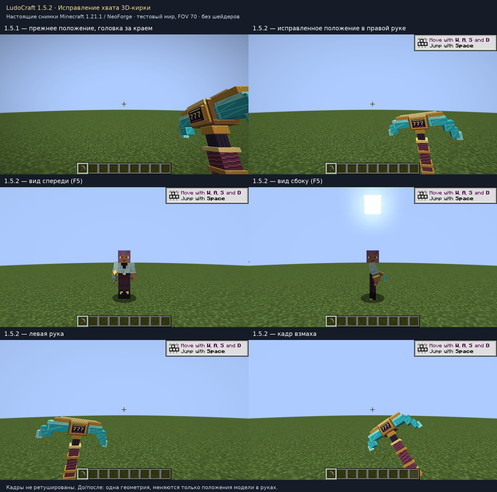

# 1.5.2 — исправление положения 3D-кирки в руках

**Это настоящие снимки игрового мира Minecraft 1.21.1 / NeoForge 21.1.265, не макеты.**
Клиент автоматически запускается в Xvfb/Mesa, создаёт плоский мир, выдаёт кирку,
переключает ведущую руку и F5-камеру, делает кадр взмаха. Шейдеров и других модов нет.
Сводный лист только размещает исходные кадры рядом с подписями: содержимое кадров не ретушируется.

## Что исправлено

- В первом лице уменьшен масштаб `.85 → .60`, модель отодвинута от камеры и края экрана.
  Вместо поворота на −90° используется −25°: головка видна целиком и не закрывает прицел в покое.
- Для третьего лица заново настроены поворот и точка хвата: рукоять проходит через ладонь,
  наклонена вперёд от предплечья; головка ориентирована в плоскости удара, а не поперёк тела.
- Левая рука учитывает автоматическое зеркалирование Minecraft: противоположные углы
  не задаются повторно поверх зеркалирования движком.
- Геометрия, текстура, 777 с обеих сторон и положение в инвентаре не менялись.
  Кирка 85/15, множители ×2–×5, эффекты, Карманная Лудка и баланс Evolution не изменены.

## Исходные кадры

| Проверка | PNG |
|---|---|
| До: исходное положение 1.5.1 | [Правая рука](hand-before-first-right.png) |
| После: первое лицо | [Правая](hand-after-first-right.png) · [Левая](hand-after-first-left.png) |
| После: третье лицо | [Спереди](hand-after-third-front.png) · [Сбоку](hand-after-third-side.png) · [Левая рука](hand-after-third-left.png) |
| После: взмах | [Один кадр анимации](hand-after-first-swing.png) |

«До» получено временным применением старого first-person transform 1.5.1 **в памяти**:
та же модель, тот же клиент и мир. Затем восстанавливается фактическое положение
из проверяемого JSON. Это не скриншот пользователя и не отдельный запуск старого JAR.

Точные коммит и Actions run для исходных кадров записаны в [capture.json](capture.json).
В F5 используется настоящий локальный персонаж; для бокового обзора поворачивается
голова/камера при фиксированном направлении корпуса. Поле зрения 70°, view bob выключен.

## Проверки и их границы

- Геометрия: 241 грань, замкнутая связная поверхность, UV, отсутствие внутренних/дублированных граней.
- Численные регрессии: головка помещается в неподвижную проекцию 16:9 и 4:3;
  точки хвата обеих рук попадают в область ладони. Старое положение 1.5.1 отвергается.
- Настоящий клиент: baking, создание мира, семь снимков; проверка наличия кирки
  вне hotbar, чтобы пустая сцена не считалась успешной проверкой.
- Отдельно просмотрены игровые кадры первого/третьего лица, обеих рук и одного взмаха.
  Это **не ручное прохождение** и не проверка каждого кадра анимации.
- Сохраняются чистые тесты механики, 8 обычных и 2 Evolution GameTests,
  проверка включения JSON/PNG и исключения тестового кода из JAR.

Полная FTB Evolution, сторонние шейдеры/анимации, нестандартный FOV, бег с view bob
и все фазы взмаха не проверены. Расчёт 4:3 не является отдельным игровым скриншотом 4:3.

## Установка

[Скачать ludocraft-1.5.2.jar](https://github.com/nightmare-huy/LudoCraft-/releases/download/v1.5.2/ludocraft-1.5.2.jar)
· [Релиз и SHA256SUMS](https://github.com/nightmare-huy/LudoCraft-/releases/tag/v1.5.2).

Удалите старый JAR из `mods`, поставьте новый на клиент и сервер. Уже существующие
кирки автоматически изменят вид. Установленный datapack Evolution можно оставить;
повторный ZIP не нужен. Опубликованный JAR 1.5.1 не перезаписывается.
