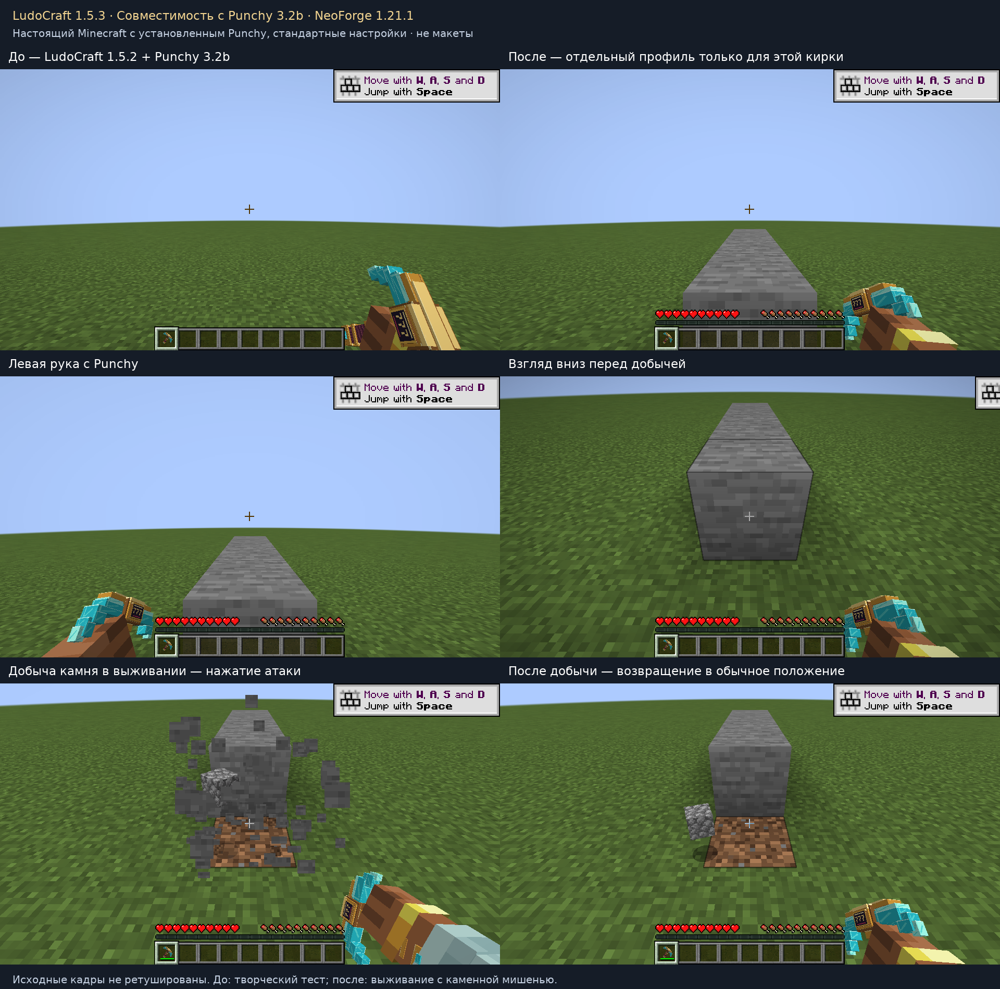

# 1.5.3 — совместимость кирки с Punchy 3.2b

**Настоящие игровые снимки с установленным `punchy-3.2b-neoforge-1.21.1.jar`.**
Предыдущая проверка 1.5.2 без модов анимации не покрывала этот случай.
С точной версией пользователя проблема воспроизведена: головка заваливалась и уходила за нижний край.

## Исправление

Встроен ресурс `assets/minecraft/punchy/compat/ludocraft_gamblers_pickaxe.json`:
профиль **только** для `ludocraft:gamblers_pickaxe`, обе руки, поправка вращения X −90°
в системе координат Punchy и относительный масштаб 0.9. Это не значения vanilla `display`.
Профиль загружается штатной системой совместимости Punchy из ресурсов LudoCraft.
Отдельный ресурс-пак, команды или сброс пользовательского конфига не требуются.

Не изменены: стандартная JSON-модель и текстура кирки, её положения без Punchy,
вид от третьего лица, другие инструменты, руки/анимации Punchy, механика 85/15,
джекпот, Карманная Лудка и цены Evolution. Punchy **не обязателен**, не включён в наш JAR
и не устанавливается модом автоматически.

## Что действительно проверено

- Minecraft **1.21.1**, NeoForge **21.1.265**, Punchy **3.2b**, свежий стандартный конфиг.
- JAR Punchy скачан из [официального файла версии](https://api.modrinth.com/v2/version/aVZEe0j8)
  и проверен по SHA-512; загрузка именно 3.2b подтверждается внутри Minecraft.
- Клиентский тест проверяет не только наличие файла: **разрешённый Punchy профиль**
  обеих рук совпадает с JSON из ресурсов, а обычная алмазная кирка не получает этот профиль.
- В настоящем мире сняты правая/левая рука, взгляд вниз, F5 спереди/сбоку,
  взмах, три кадра добычи камня и возврат в покой — всего **11 кадров**.
- Добыча запускается через нажатую клавишу атаки в **выживании**;
  тест подтверждает разрушение каменной мишени, а не только вызов `swing()`.
- Дополнительный контроль PNG проверяет наличие головки и её отступ от краёв
  в четырёх положениях покоя. Снимки просмотрены отдельно; проверка пикселей не доказывает хороший хват сама по себе.
- Повторяется обычный клиентский тест **без Punchy**, чистые тесты механик,
  8 обычных + 2 Evolution GameTests, проверка содержимого JAR.
- Публикация релиза зависит от успешного завершения **обоих** клиентских запусков.

**Ограничения:** это автоматизированные игровые сцены, не ручное прохождение полной FTB Evolution.
Шейдеры, другие моды анимации, изменённые пресеты Punchy, произвольный FOV и все кадры
всех анимаций не проверены. Поле зрения 70°, vanilla view bob выключен;
настройки самого Punchy оставлены стандартными. Во время удара выход предмета за кадр может быть частью анимации.

## Кадры и происхождение

- До исправления: [правая рука](punchy-before/punchy-after-first-right.png),
  [взгляд вниз](punchy-before/punchy-looking-down.png), [коммит и запуск](punchy-before/capture.json).
- После: [правая](punchy/punchy-after-first-right.png), [левая](punchy/punchy-after-first-left.png),
  [взгляд вниз](punchy/punchy-looking-down.png).
- F5: [спереди](punchy/punchy-after-third-front.png), [сбоку](punchy/punchy-after-third-side.png),
  [левая рука](punchy/punchy-after-third-left.png).
- Добыча: [начало](punchy/punchy-mining-start.png), [середина](punchy/punchy-mining-middle.png),
  [конец](punchy/punchy-mining-end.png), [возврат](punchy/punchy-mining-recovered.png).
- [Точный коммит и Actions run кадров после исправления](punchy/capture.json).

Сводный лист только располагает исходные PNG с подписями; кадры не ретушируются.
Сцена «до» — творческий плоский мир, «после» — выживание с добавленной каменной мишенью.
Оба запуска действительно содержат Punchy 3.2b; это не имитация его преобразований.

Система совместимости описана в [официальной wiki Punchy](https://github.com/punchy-guys/punchy-wiki/wiki/Punchy!-Resource-Pack-Compatibility-Guide-EN-US).
Тестовый перебор положений доступен через `-PpunchySweep=true`; его временные ресурс-паки
создаются только внутри игнорируемой папки `run`, не включаются в мод и не используются в релизной проверке.

## Установка

[Скачать ludocraft-1.5.3.jar](https://github.com/nightmare-huy/LudoCraft-/releases/download/v1.5.3/ludocraft-1.5.3.jar)
· [Релиз и SHA256SUMS](https://github.com/nightmare-huy/LudoCraft-/releases/tag/v1.5.3).

Замените старый LudoCraft JAR в `mods` клиента и сервера, затем перезапустите игру.
Уже установленный Punchy 3.2b и его конфиг оставьте. Datapack Evolution менять не нужно.
